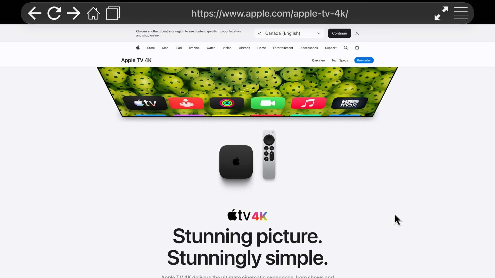
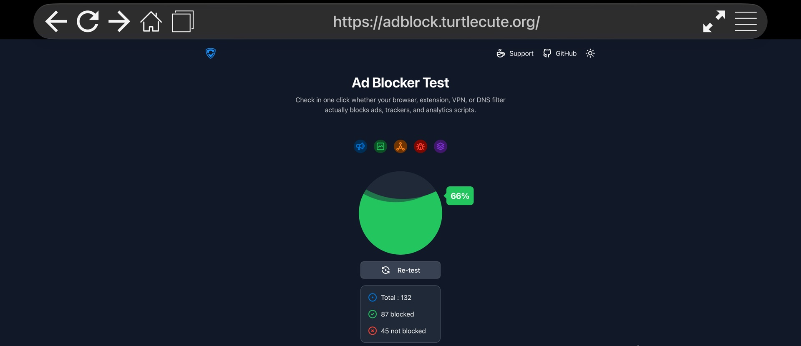
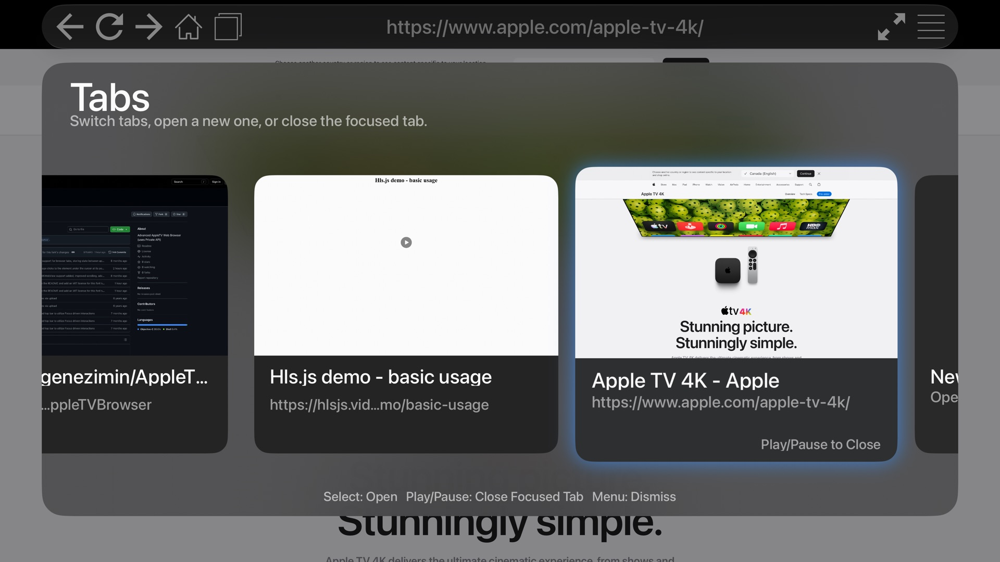
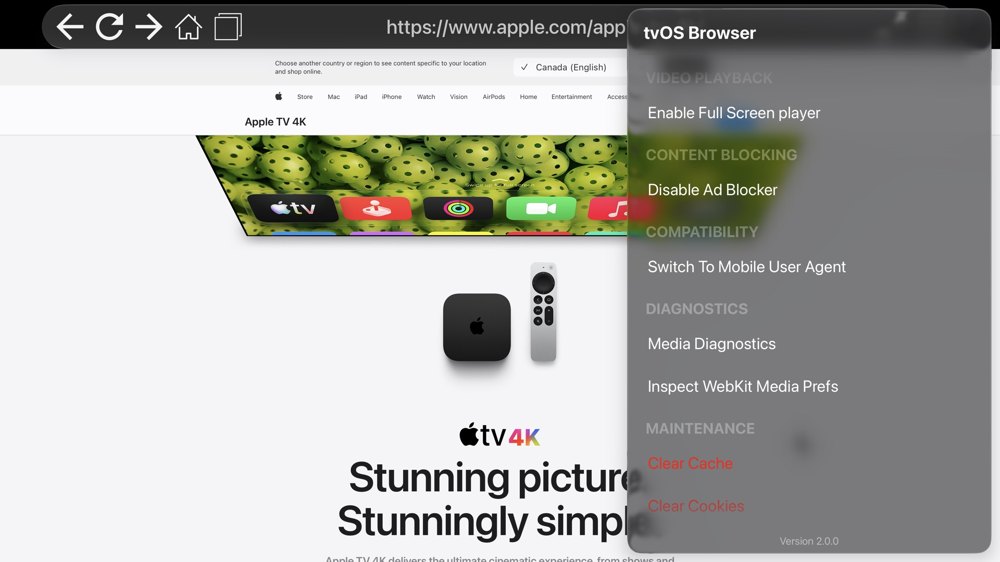
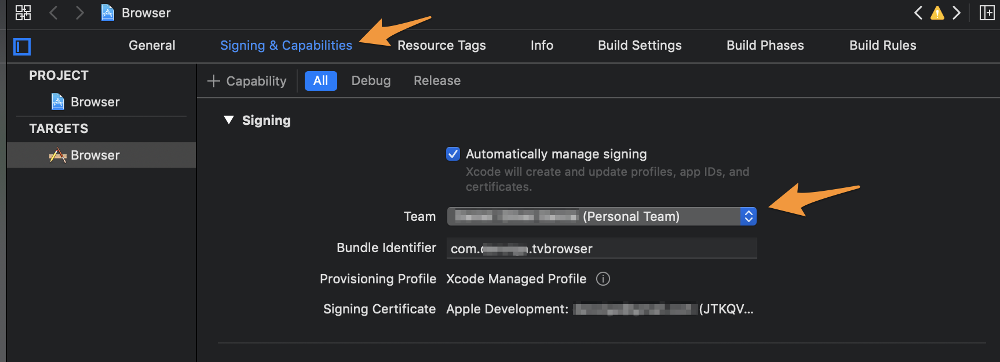

# tvOS Browser

**Watch anything. Browse everything. Skip the ads.**

Apple TV ships without a web browser, and on tvOS web pages can't even take a video full
screen. tvOS Browser is built around fixing exactly that: it plays web video in Apple's own
full-screen player, renders modern sites the way Safari does, and blocks ads and trackers before
they load, all driven by the Siri Remote.


## Plays the videos other browsers can't

On tvOS, WebKit can't show web video full screen, so in other browsers a video stays stuck in a
small box on the page, if it plays at all. tvOS Browser picks up the stream the page's player is
loading (HLS or MP4) and hands it to **Apple's native video player**, the same one Apple's own
apps use.

- **One press to full screen.** Hit the full-screen button in a site's video player and the
  video opens natively, picking up exactly where you were.
- **Proper controls.** Swipe to scrub, click to pause, skip 10 seconds with a press, or use the
  on-screen **back 10 s / play-pause / forward 10 s** buttons.
- **Your choice of quality.** When a site offers several qualities, you pick the one you want.
- **Smooth streaming.** HLS and MP4 streams play with AVPlayer's own buffering, so long films
  don't stutter or eat memory.

## Works with the modern web



- **Safari-grade rendering.** Pages are drawn by WebKit, the engine behind Safari, so modern
  sites look and behave the way they should.
- **Clicks that land where you point.** Every click is delivered exactly like a real mouse
  click, so progress bars, sliders and menus in web apps respond correctly.
- **Built for today's tvOS.** Updated for tvOS 26 and 27, with the Liquid Glass look and the
  stability fixes newer tvOS versions require.
- **Desktop or mobile.** Switch between desktop and mobile versions of a site, scale pages to
  fit the TV and adjust the font size.

## Blocks ads and trackers



<p align="center"><em>87 of 132 ad and tracker tests blocked on adblock.turtlecute.org, out of the box.</em></p>

Around **150,000 rules** from the same filter lists that power uBlock Origin (EasyList,
EasyPrivacy, uBlock filters and RU AdList) stop ads and trackers before they even load, on every
tab. Pages load faster, look cleaner and track you less. If a site misbehaves, switch blocking
off from the side menu in one click.

## And everything you'd expect from a browser

<p align="center">
  
  
</p>

- **A cursor that feels right.** Pointer acceleration makes slow movements precise enough for
  the smallest links, while quick swipes still cross the screen in a flash. Double-click to
  switch to scroll mode and flick through long pages.
- **Tabs, favorites and history.** Keep several sites open, flip between them in a visual tab
  overview, and keep your favorite pages one click away.
- **Liquid Glass design.** The top bar and side menu fit right in next to Apple's own apps.

> [!IMPORTANT]
> tvOS Browser uses private Apple APIs (tvOS has no public web view), so it can't be distributed
> through the App Store. You build it yourself with Xcode and install it on your own Apple TV.
> Please don't publish builds of it to the App Store.

## What you need

- A Mac with **Xcode 27** or later (tvOS 26 SDK or newer)
- An **Apple TV** running **tvOS 26** or later, on the same network as the Mac
- An **Apple ID**. A free one works; a paid Apple Developer Program membership is optional
  (see [How long the app keeps working](#how-long-the-app-keeps-working))

## Installation

### 1. Get the code

```sh
git clone https://github.com/eugenezimin/AppleTVBrowser.git
cd AppleTVBrowser
open _Project/Browser.xcodeproj
```

### 2. Add your Apple ID to Xcode

In Xcode, open **Settings → Accounts**, click **+**, and sign in with your Apple ID.

### 3. Pair your Apple TV with your Mac

1. On the Apple TV, open **Settings → Remotes and Devices → Remote App and Devices** and stay on
   that screen.
2. On the Mac, open Xcode's **Window → Devices and Simulators**. Your Apple TV appears under
   **Discovered**.
3. Click **Pair** and enter the code shown on the TV.
4. If the Apple TV asks you to turn on **Developer Mode** (**Settings → Privacy & Security →
   Developer Mode**), turn it on and let it restart.

### 4. Set up signing

1. In Xcode's project navigator, select the **Browser** project, then the **Browser** target.
2. Open the **Signing & Capabilities** tab.
3. Keep **Automatically manage signing** checked and choose your **Team** (your Apple ID).
4. Change the **Bundle Identifier** to something unique to you, for example
   `com.yourname.tvbrowser`. Every Apple ID needs its own.



### 5. Build and run

Select your Apple TV in the run destination menu at the top of the Xcode window and press
**⌘R**. The first build takes a minute; after that, tvOS Browser appears on your Apple TV's home
screen.

### Prefer the command line?

After steps 2 to 4, you can build and install without opening Xcode again. Find your Apple TV's
identifier with `xcrun devicectl list devices`, then:

```sh
xcodebuild -project _Project/Browser.xcodeproj -scheme Browser -configuration Release \
  -destination 'platform=tvOS,name=<Your Apple TV name>' \
  -derivedDataPath _Project/build -allowProvisioningUpdates build

xcrun devicectl device install app --device <device identifier> \
  _Project/build/Build/Products/Release-appletvos/Browser.app
```

### How long the app keeps working

With a **free Apple ID**, Apple's signing expires after **7 days**: the app stops opening and you
need to run it from Xcode again. With a paid **Apple Developer Program** membership, a build
keeps working for a year.

## Using the Siri Remote

| Remote | What it does |
| --- | --- |
| Swipe on the touch surface | Move the cursor (scroll mode: scroll the page) |
| Click the touch surface | Click whatever is under the cursor |
| Double-click the touch surface | Switch between cursor mode and scroll mode |
| Press up (top edge of the touch surface) | Move focus to the top bar |
| Play/Pause | Quick menu: enter a URL or search Google, go forward, reload |
| Double-press Play/Pause | Open the side menu |
| Back / Menu | Go back; on the first page of a tab, offers to quit |

The **side menu** collects everything else: home page, tabs, favorites, history, page scaling and
font size, the video player and ad blocker switches, desktop/mobile mode, cache and cookie
clean-up, diagnostics, and a built-in usage guide.

### Watching video

- Press the **full-screen button** in a site's video player to open the video in the native
  player. This always works, no setup needed.
- Want videos to open natively as soon as you click them? Turn on **Side Menu → Video Playback →
  Enable Full Screen player**.
- In the player: click or press Play/Pause to pause and resume, **swipe** to scrub through the
  timeline and click to jump there, press the left or right edge of the touch surface to skip
  10 seconds, and swipe down to reach the on-screen **back 10 s / play-pause / forward 10 s**
  buttons. Press **Back** to return to the page.

### Blocking ads

The ad blocker is on from the first launch. The first time, it takes a few seconds to prepare its
rules in the background; after that it's instant. Turn it off or on any time from **Side Menu →
Content Blocking**.

Some sites deliver ads in ways that rule-based blockers can't stop (YouTube's video ads, for
example), so you may still see the occasional ad there.

## Keeping the filter lists fresh

The filter lists are bundled with the app. To update them to the latest versions, run the script
below on your Mac, then rebuild and reinstall:

```sh
_Project/Scripts/update-content-blockers.sh
```

It downloads the lists and converts them with AdGuard's
[SafariConverterLib](https://github.com/AdguardTeam/SafariConverterLib), which it builds
automatically (this needs Xcode's command-line tools and an internet connection).

## Troubleshooting

- **The app no longer opens.** If you sign with a free Apple ID, the 7-day signature has expired.
  Run it from Xcode again.
- **Your Apple TV doesn't show up in Xcode.** Make sure both devices are on the same network and
  the Apple TV is showing the **Remote App and Devices** screen while you pair.
- **"Native Video Unavailable".** The page didn't expose a video stream the native player can open.
  Start the video in the page first, then press the player's full-screen button. A few players
  only work through Media Source Extensions, which tvOS's WebKit doesn't provide; if such a
  player has no fallback to plain HLS or MP4, its video can't be played.
- **A site looks broken.** Try turning off the ad blocker for a moment (**Side Menu → Content
  Blocking**), or switch between desktop and mobile mode.

## Credits

tvOS Browser stands on the shoulders of:

- [Steven Troughton-Smith](https://github.com/steventroughtonsmith/tvOSBrowser), who created
  the original tvOS Browser
- [Jip van Akker](https://github.com/jvanakker/tvOSBrowser), who carried it forward with the
  WebKit engine, tabs and the Liquid Glass UI
- Everyone who has contributed to these projects over the years
- [EasyList](https://easylist.to), [uBlock Origin](https://github.com/uBlockOrigin/uAssets) and
  RU AdList for their filter lists, and [AdGuard](https://github.com/AdguardTeam/SafariConverterLib)
  for the converter that turns them into WebKit rules

## License

The changes and additions in this fork are released under the [MIT License](LICENSE). The
original tvOS Browser code belongs to its authors and was published without a license, and the
bundled filter lists keep their own licenses; see [LICENSE](LICENSE) for the details.

This software is provided as is, without warranty of any kind. Use it at your own risk.
